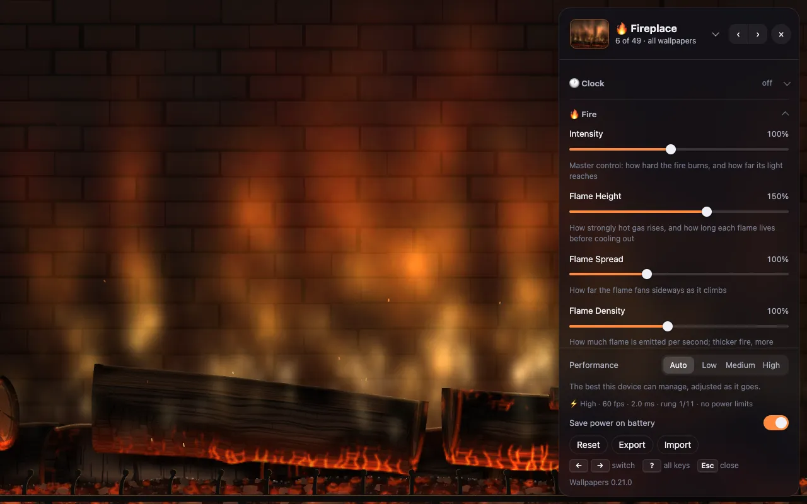
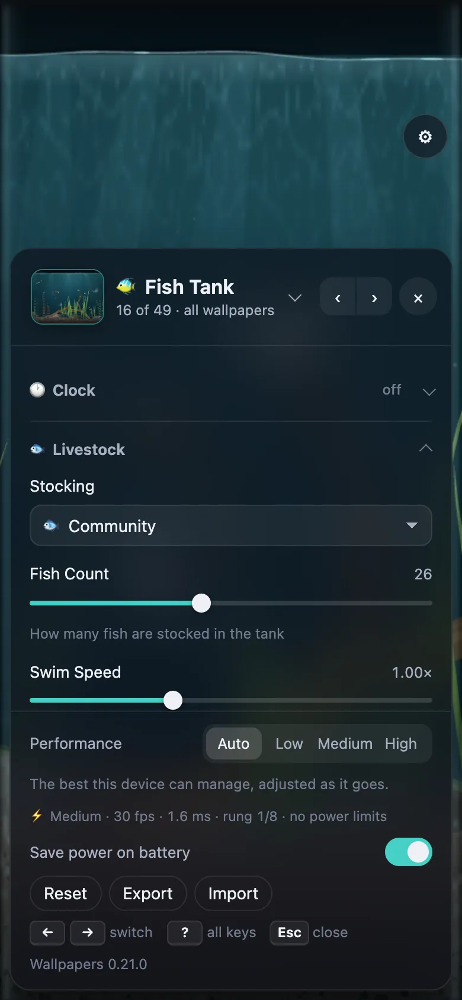
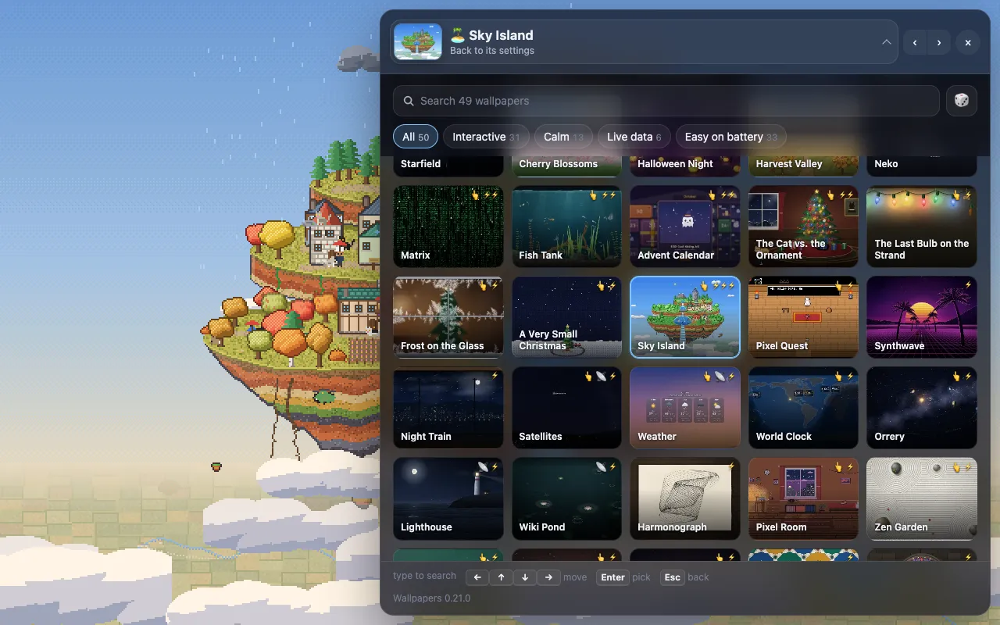
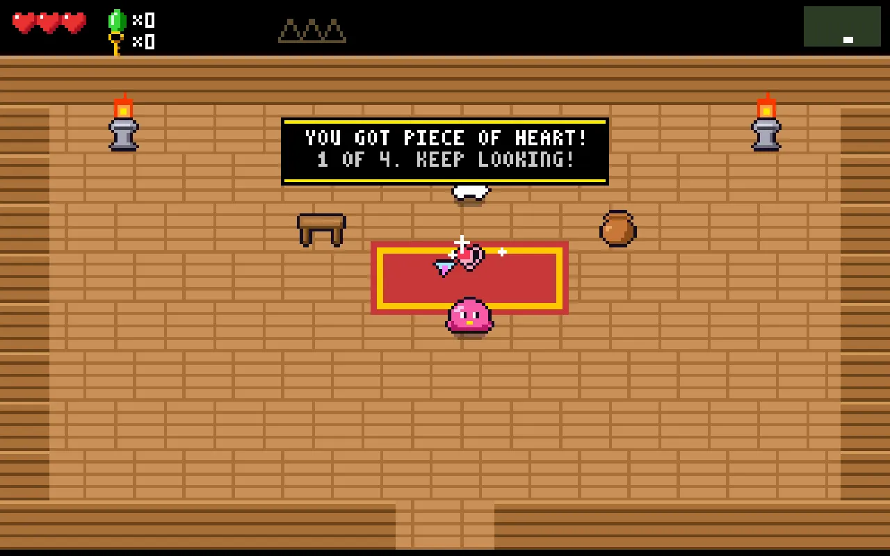

# wallpapers

Toy animated wallpapers: snow, a fireplace, northern lights, a fish tank, a
self-playing 8-bit adventure, koi, a night train, the real satellites
overhead, an orrery of the solar system right now, your own Jellyfin videos
in an old TV, endless sports leagues, a ski run, a New England town at
Christmas, and more: 50 in all. Each
one is a full-screen canvas animation with no page around it. Most just
play; some also respond to you: feed the fish, rake the sand, or take over
Pixel Quest's hero with the arrow keys.

**[Try it: nealhardesty.github.io/wallpapers](https://nealhardesty.github.io/wallpapers/)**, then press `,`.



Everything is plain HTML, CSS and JavaScript, with no build step. Most
wallpapers work fully offline; the online ones need no API keys. How it all
works is in [SPEC.md](SPEC.md).

## Install

Downloads are on the [latest release](https://github.com/nealhardesty/wallpapers/releases/latest).
Each zip has a `.sha256` beside it.

| Where | Get it | How |
|---|---|---|
| **Web page** | [Hosted copy](https://nealhardesty.github.io/wallpapers/) | Open it, or `web/index.html` from a clone, or `make serve`. Set it as Chrome's startup page if you like |
| **Any phone** | [Hosted copy](https://nealhardesty.github.io/wallpapers/) | Browser menu → *Add to Home screen*. Opens full screen |
| **Chrome new tab** | `wallpapers-extension-<version>.zip` from [Releases](https://github.com/nealhardesty/wallpapers/releases/latest) | Unzip, then **Load unpacked** (below) |
| **Android live wallpaper** | `wallpapers-<version>.apk` from [Releases](https://github.com/nealhardesty/wallpapers/releases/latest) | Sideload it, open **Wallpapers**, **Set as wallpaper** |
| **macOS 14+ desktop and screen saver** | `wallpapers-mac-<version>.zip` from [Releases](https://github.com/nealhardesty/wallpapers/releases/latest) | Unzip, move `Wallpapers.app` to `~/Applications`, first open via right-click → **Open** |
| **Windows 11 desktop and screen saver** | `wallpapers-windows-<version>.zip` from [Releases](https://github.com/nealhardesty/wallpapers/releases/latest) | Unzip, run `Wallpapers.exe`, choose **Install** or **Just Run** |
| **Self-hosted** | A clone | `make docker-build && make docker-run`, then http://localhost:8000 |

<details>
<summary><b>Chrome extension</b></summary>

1. Unzip the extension somewhere it can stay (or build it: `make extension` → `dist/extension/`).
2. `chrome://extensions` → turn on **Developer mode** → **Load unpacked** → pick that folder.
3. Open a new tab; Chrome asks once whether to keep the change. Keep it.

Its ID is always `hajnldgffgkdnbimdihipffnimjckgcp`, so a new version unpacked
elsewhere keeps your settings. Chrome focuses the address bar on a new tab:
click the page before pressing `,`, or use the gear top-right. Its one
permission reads `www.bing.com` for the Bing wallpaper.

**Coming from the old homepage?** Its wallpaper settings can come with you.
On an old homepage tab, open the console (⌥⌘J / Ctrl+Shift+J; type `allow
pasting` if asked), paste this, and press Enter to download
`homepage-wallpapers.json`:

```js
(() => {
  const keep = k => /Config$/.test(k) || ['wallpaperPreference', 'adventCelebrated', 'adventLastSeen'].includes(k);
  const data = { app: 'homepage', exported: new Date().toISOString(),
    localStorage: Object.fromEntries(Object.keys(localStorage).filter(keep).map(k => [k, localStorage.getItem(k)])) };
  const a = document.createElement('a');
  a.href = URL.createObjectURL(new Blob([JSON.stringify(data, null, 2)], { type: 'application/json' }));
  a.download = 'homepage-wallpapers.json';
  a.click();
})();
```

Turn the old homepage off, install this extension, open a new tab, press
`,` → **Import** and pick the file. It imports on the hosted copy and on
Android too.
</details>

<details>
<summary><b>Android</b></summary>

Your phone asks once to allow installs from the browser (or `make
android-install` with a phone connected). Open **Wallpapers** from the app
drawer: it's the panel, with a **Set as wallpaper** button. Taps and drags
reach the wallpaper, depth layers pan as you swipe home screens, and it
pauses when covered and runs at Medium, 30 fps at most. More in SPEC §6.
</details>

<details>
<summary><b>macOS</b></summary>

The app isn't notarized, so macOS blocks it the first time: right-click →
**Open**, or `xattr -dr com.apple.quarantine ~/Applications/Wallpapers.app`.
Or build it yourself: `make mac-run` / `make mac-install`. The wallpaper sits
behind your icons on every display; the menu bar item picks a wallpaper,
pauses, opens **Settings** and sets open-at-login. For the screen saver: menu
bar item → **Screen Saver → Install Screen Saver…**, then pick **Wallpapers**
under System Settings → Wallpaper → Screen Saver → Other. More in SPEC §10.21
(macOS).
</details>

<details>
<summary><b>Windows</b></summary>

The exe is unsigned by default: SmartScreen asks, so **More info → Run
anyway** (or right-click the zip → Properties → **Unblock** first).
**Install** puts it in `%LOCALAPPDATA%\Programs\Wallpapers` (no admin), in the
Start menu and Settings → Apps, starting with Windows; running a newer
download offers **Update**. A tray icon (drag it out from behind **^**)
picks wallpapers, per-monitor or the same on all, performance, **Play in a
Window…** for wallpapers that want keys, and **Screen Saver → Use Wallpapers
as the Screen Saver…** (installed copy only). It pauses whenever it can't be
seen. Uninstall from Settings → Apps. Data and logs live in
`%LOCALAPPDATA%\Wallpapers`. More in SPEC §10.25.
</details>

## Use

On first run it's **Seasonal** 📅, which picks by month: snow in winter, the
fish tank in May, fireflies in summer, leaves in September, Halloween,
Harvest Valley in November, and a different Christmas wallpaper each day in
December, with Sky Island every other day all year.

| Key | Action |
|---|---|
| `,` or `c` | The panel: the current wallpaper's settings, and the gallery |
| `[` / `]` | Previous / next wallpaper (remembered); `←` / `→` too while the panel is open |
| `f` | Fullscreen |
| `k` | The clock, on or off |
| `?` | All keys, including the current wallpaper's own |
| `Esc` | Close |

On a touch screen, hold a right-hand corner for the panel; with a mouse, a
gear appears near that corner. The left-hand corners toggle fullscreen. The
Android live wallpaper leaves its corners to the launcher: its settings are
in the app.



**The panel.** Its header shows the current wallpaper (thumbnail and name)
with ‹ › to step through them. Click it to open the **gallery**: the panel
widens into a grid of every wallpaper with a search box (just start typing),
filter chips (All, Interactive, Calm, Live data, Easy on battery), a 🎲
**Surprise me** button, and live previews on hover. Arrow keys move around;
Enter or a click picks one, Esc goes back to settings. `?panel=gallery`
opens straight into it.



Below the header:
- The wallpaper's settings, live as you change them. A dot marks a changed
  setting; click it to put it back.
- **Performance**: **Auto** (default) trades detail for smoothness as the
  device needs, and remembers per wallpaper; **Low**, **Medium**, **High** pin
  it. **Save power on battery** keeps Auto at Medium or below. ⚡ badges show
  how hard each wallpaper works a phone (SPEC §4.8).
- **Clock**: a clock over any wallpaper, in many formats, looks and
  positions (drifting, bouncing, following the pointer), with a second
  timezone and a dim-at-night option (SPEC §4.9).
- Reset, Export and Import, to move settings to another browser.

**Interactive wallpapers** (👆 in the [appendix](#appendix-the-wallpapers))
respond to taps, drags or keys: press `?` on one to see its keys. Each has a
setting to ignore touch, and on Android a sideways swipe between home
screens never counts.

**Online, but never blank** (📡): Weather and Lighthouse (Open-Meteo),
Satellites (CelesTrak) and Wiki Pond (Wikipedia's live edits) draw their own
scene offline. Weather and Satellites ask where you are, typed or from the
device, rounded to about 10 km and kept in your browser. The Bing photo needs
a page that's served: locally, `make bing-json` then `make serve`.

<br clear="right">

### Jellyfin 📺

Plays your own [Jellyfin](https://jellyfin.org) server's playlists, libraries
or favourites in a frame drawn in code (an old TV, a mantel, a drive-in, a
cinema, Christmas frames and more).
1. In the panel pick 📺 Jellyfin, type your server's address, press **Connect**.
2. **Sign in with Quick Connect** and enter the six digits in any signed-in
   Jellyfin app (or use a username and password; the password is never
   stored).
3. Pick what to play. Sign out tells the server to forget this device.

It starts muted (`M` or a tap for sound), resumes where it left off, picks
subtitles for you, and plays in one tab at a time (tap "Playing in another
tab" to take it back). The sign-in never leaves the device
(Export skips it). From the hosted https copy, allow Chrome's "local network"
prompt and use the server's IP address for an http server; on Android allow
"Nearby devices". Details in SPEC §10.21 (Jellyfin).

### URL options

For this visit only; nothing is saved.

| Add to the URL | Effect |
|---|---|
| `?w=fishtank` | Show this wallpaper |
| `?panel=open` | Open its settings on load (`?panel=gallery`: the gallery) |
| `?date=2026-12-31T23:59:50` | Time-travel anything that follows the date or hour (advent: `&theme=`) |
| `?tier=low` | Low, medium or high performance tier |
| `?hud=1` | A corner readout: frame rate, frame cost, quality step, power |
| `?seed=7` | The same random scene every time |
| `?clock=on` / `off` / `bounce` | Try the clock overlay for one load |

`web/stage.html?w=<id>` shows one wallpaper without the player around it.



## Development

You need `make`, `git` and Node.js 22+. No npm packages. Optional: Chrome or
Chromium for `make smoke` (`CHROME_PATH=` if not found), `openssl` for https,
Docker, the .NET 10 SDK for the Windows app (cross-compiles in WSL or Linux;
`make ci` skips its tests without it), and the Android SDK plus JDK 17+ for
Android (found where Android Studio puts them; `ANDROID_HOME=`, `JAVA_HOME=`).

```sh
make hooks   # audit every commit, commit message and push
make ci      # lint, audit and test: the same thing CI runs
```

Run `make` (that's `make help`) to list every target with its description.

| Area | Targets |
|---|---|
| Run it | `open` (opens `web/index.html`; `PAGE='?w=harvest'`), `serve-http` (:8000; `HOST=0.0.0.0` for the LAN), `serve-https` (:8443, self-signed; `make serve` is the same), `cert` |
| Check | `lint`, `audit`, `audit-staged`, `audit-history`, `test`, `smoke` (screenshots in `dist/smoke/`), `smoke-clock`, `smoke-live` (against the deployed site), `ci` (everything CI runs) |
| Performance | `bench` (every wallpaper, every tier, simulated phone; writes the ⚡ badges), `bench-clock`, `android-bench` (on a real phone), `wayfarer-sight`, `wayfarer-budget` (Wayfarer's triangles a frame, by tier and place) |
| Generated, committed | `thumbnails`, `screenshots`, `icons`, `world-land`, `world-atlas`, `jellyfin-fixtures` (review the diffs) |
| Build | `extension`, `site` (GitHub Pages copy), `bing-json`, `docker-build`, `docker-run`, `clean` |
| Debug aids | `ski-filmstrip` (Fresh Tracks motion as frames and plots), `wayfarer-gait` (Wayfarer's animals walking, as frames), `wayfarer-models` (Wayfarer's trees and houses at each level of detail), `jellyfin-media`, `jellyfin-dev` (Docker Jellyfin at :8096, user and password `wallpapers`), `jellyfin-stop`, `jellyfin-mock` (fixture API at :8097) |
| Android | `android-build`, `android-install`, `android-logcat`, `android-emulator` (`AVD=`), `android-keystore` (once, ever), `android-release` |
| macOS | `mac-build`, `mac-run`, `mac-dev` (from this checkout's `web/`), `mac-test`, `mac-release`, `mac-install`, `mac-uninstall`, `mac-saver-test`, `mac-saver-live`, `mac-saver-log` |
| Windows | `win-build`, `win-run` (from WSL), `win-dev`, `win-reload`, `win-unit`, `win-test`, `win-test-zip`, `win-release`, `win-sign`, `win-sign-tools`, `win-install`, `win-uninstall`, `win-saver`, `win-log` (`FLAVOR=`, `FOLLOW=1`) |
| Setup | `hooks`, `help` |

**Phones:** `HOST=0.0.0.0 make serve-https` and open the printed address;
accept the self-signed certificate once (or trust `.cert/cert.pem`).

**Jellyfin without a server:** `make jellyfin-media && make jellyfin-dev`,
then point the wallpaper at `localhost:8096`. For a phone,
`JELLYFIN_HOST=0.0.0.0 make jellyfin-dev`; the Android emulator can reach
`make jellyfin-mock` (port 8097) but not Docker Desktop's ports.

### Releasing

1. Once: `make android-keystore`, back the key up, and `gh secret set` the
   four `WALLPAPERS_KEY*` secrets it prints. Losing it means people must
   uninstall to update. Without them CI ships a debug APK instead.
2. Bump `version` in `web/manifest.json`, commit, and push a matching tag:
   `git tag v0.6.0 && git push --tags`.
3. CI checks everything and publishes a GitHub Release with the APK, the
   extension zip, the universal Mac zip and the Windows zip, each with a
   `.sha256`. If the Mac build or the Windows self-test fails, the release
   goes out without it and the run warns.
4. `gh workflow run ci.yml --ref <branch>` tries the Mac build without
   publishing; every CI run uploads the Windows zip as an artifact.
5. The Mac app is ad-hoc signed, not notarized. The Windows app is unsigned
   unless all six `WALLPAPERS_SIGN_*` secrets (Azure Trusted Signing) are
   set; `make win-release` ends by saying `signed` or `unsigned`. Never
   commit a value. Details in SPEC §10.25.

### Adding a wallpaper

See "Building a new wallpaper" in [AGENTS.md](AGENTS.md) and SPEC §4. In
short: a folder under `web/wallpapers/` with the code, `defaults.js` and
`settings.js`, an entry in `catalog.js`, `make thumbnails`, and `make ci`.

### Keeping it public-safe

`make audit` fails on private IP addresses, email addresses (other than
`noreply@`), home-directory paths, strings shaped like API keys, URLs off the
allowlist in `tools/audit.mjs`, image metadata, and files over 1 MB. Put your
own personal terms one per line in `.audit-denylist` (git-ignored). With
`make hooks` it runs on each staged commit, each commit message, and the full
history before each push. Findings are redacted; mark a false positive with
`audit-allow: <reason>` on that line or the one above. More in SPEC §7.

## Appendix: the wallpapers

Click a name to see it live. 👆 responds to you · 📡 uses the network (and
still draws offline). 📅 **Seasonal** isn't one itself: it picks one by date.

| Wallpaper | | What it is |
|---|:-:|---|
| ⬛ [Blank](https://nealhardesty.github.io/wallpapers/?w=blank) | | Just black |
| ❄️ [Snow](https://nealhardesty.github.io/wallpapers/?w=snow) | | Snow falling |
| 🌧️ [Rain](https://nealhardesty.github.io/wallpapers/?w=rain) | | Rain falling |
| 🍂 [Falling Leaves](https://nealhardesty.github.io/wallpapers/?w=leaves) | | Autumn leaves on the wind |
| ✨ [Fireflies](https://nealhardesty.github.io/wallpapers/?w=fireflies) | | Fireflies drifting on a summer night |
| 🔥 [Fireplace](https://nealhardesty.github.io/wallpapers/?w=fireplace) | | Real-looking wood burning down to coals, laid how you like |
| 🌌 [Northern Lights](https://nealhardesty.github.io/wallpapers/?w=northern-lights) | | The aurora rippling over a night sky |
| ☁️ [Parallax Clouds](https://nealhardesty.github.io/wallpapers/?w=parallax-clouds) | | Layers of clouds drifting by |
| 🏔️ [Mountains](https://nealhardesty.github.io/wallpapers/?w=mountains) | | Layered mountain ranges |
| 🌠 [Starfield](https://nealhardesty.github.io/wallpapers/?w=starfield) | | A deep field of drifting stars |
| 🌸 [Cherry Blossoms](https://nealhardesty.github.io/wallpapers/?w=cherry-blossoms) | 👆 | A blossoming bough; shake it, or puff the wind |
| 🎃 [Halloween Night](https://nealhardesty.github.io/wallpapers/?w=halloween) | 👆 | A spooky night; light the jack-o'-lanterns |
| 🌾 [Harvest Valley](https://nealhardesty.github.io/wallpapers/?w=harvest) | 👆 | A cosy Thanksgiving valley under the real moon |
| 🐈 [Neko](https://nealhardesty.github.io/wallpapers/?w=neko) | 👆 | The classic cat that chases your pointer |
| 🟩 [Matrix](https://nealhardesty.github.io/wallpapers/?w=matrix) | 👆 | The film's falling code |
| 🐠 [Fish Tank](https://nealhardesty.github.io/wallpapers/?w=fishtank) | 👆 | An aquarium; click to feed the fish |
| 🎁 [Advent Calendar](https://nealhardesty.github.io/wallpapers/?w=advent) | 👆 | A door a day through December |
| 🐾 [The Cat vs. the Ornament](https://nealhardesty.github.io/wallpapers/?w=cat-ornament) | 👆 | Nine cats, one low ornament, and sometimes the tree comes down |
| 💡 [The Last Bulb on the Strand](https://nealhardesty.github.io/wallpapers/?w=last-bulb) | 👆 | Old C9 lights, and the loose last bulb |
| 🧊 [Frost on the Glass](https://nealhardesty.github.io/wallpapers/?w=frost) | 👆 | Frost creeping over a window onto a warm room |
| 🎄 [A Very Small Christmas](https://nealhardesty.github.io/wallpapers/?w=small-christmas) | 👆 | A tiny pixel tree with a toy train |
| ☃️ [Christmas Village](https://nealhardesty.github.io/wallpapers/?w=christmas-village) | 👆 | A New England town in the snow: skaters, a grand tree, cats |
| 🖼️ [Painted Village](https://nealhardesty.github.io/wallpapers/?w=painted-village) | 👆 | The whole village from the hill, as a painting: lamplight on snow, a toy train, a sledding hill, bears in the woods |
| 🏝️ [Sky Island](https://nealhardesty.github.io/wallpapers/?w=sky-island) | 👆 | A pixel village on a floating island, new each load |
| ⚔️ [Pixel Quest](https://nealhardesty.github.io/wallpapers/?w=quest) | 👆 | A self-playing 8-bit adventure; take over the hero |
| 🌇 [Synthwave](https://nealhardesty.github.io/wallpapers/?w=synthwave) | | The endless neon drive |
| 🚆 [Night Train](https://nealhardesty.github.io/wallpapers/?w=night-train) | | The view from a train at night |
| 🛰️ [Satellites](https://nealhardesty.github.io/wallpapers/?w=satellites) | 👆 📡 | The real satellites crossing your sky |
| 🌦️ [Weather](https://nealhardesty.github.io/wallpapers/?w=weather) | 👆 📡 | Your forecast, over a sky that matches outside |
| 🌍 [World Clock](https://nealhardesty.github.io/wallpapers/?w=world-clock) | 👆 | Your cities on the real day-and-night world |
| 🪐 [Orrery](https://nealhardesty.github.io/wallpapers/?w=orrery) | 👆 | The solar system as it is right now |
| 🌊 [Lighthouse](https://nealhardesty.github.io/wallpapers/?w=lighthouse) | 📡 | A lighthouse keeping a real light's rhythm |
| 🪷 [Wiki Pond](https://nealhardesty.github.io/wallpapers/?w=wiki-pond) | 📡 | Every Wikipedia edit as a ripple on a pond |
| 🖋️ [Harmonograph](https://nealhardesty.github.io/wallpapers/?w=harmonograph) | | A pendulum pen inking its figures |
| 🛋️ [Pixel Room](https://nealhardesty.github.io/wallpapers/?w=pixel-room) | 👆 | A pixel-art room with a cat that keeps real hours |
| 🪨 [Zen Garden](https://nealhardesty.github.io/wallpapers/?w=zen-garden) | 👆 | Sand and stones to rake |
| 🎏 [Koi Pond](https://nealhardesty.github.io/wallpapers/?w=koi-pond) | 👆 | Koi to feed and ripple |
| 🪟 [Rainy Window](https://nealhardesty.github.io/wallpapers/?w=rainy-window) | 👆 | A fogged, rainy window to draw on |
| 🎆 [Fireworks](https://nealhardesty.github.io/wallpapers/?w=fireworks) | 👆 | Fireworks, with a New Year's countdown |
| ✴️ [Girih](https://nealhardesty.github.io/wallpapers/?w=girih) | | Islamic star patterns that breathe |
| ⛪ [Stained Glass](https://nealhardesty.github.io/wallpapers/?w=stained-glass) | | A stained-glass window lit by the time of day |
| 🐦 [Murmuration](https://nealhardesty.github.io/wallpapers/?w=murmuration) | 👆 | A starling flock; scatter it as the falcon |
| 🏮 [Lantern Festival](https://nealhardesty.github.io/wallpapers/?w=lanterns) | 👆 | Sky lanterns to release |
| 📺 [Jellyfin](https://nealhardesty.github.io/wallpapers/?w=jellyfin) | 👆 📡 | Your own Jellyfin videos in a frame of your choice |
| 🛩️ [Ice Patrol](https://nealhardesty.github.io/wallpapers/?w=ice-patrol) | 👆 | A low flight over an ice world, from the cockpit (WebGL) |
| 🤼 [Sumo Championship](https://nealhardesty.github.io/wallpapers/?w=sumo) | 👆 | An endless tournament as a moving woodblock print |
| 🏒 [Pocket Hockey](https://nealhardesty.github.io/wallpapers/?w=pocket-hockey) | 👆 | An invented three-on-three hockey league, in pixel art |
| ⚾ [The Never-Ending Baseball Season](https://nealhardesty.github.io/wallpapers/?w=baseball) | 👆 | A whole pixel-art league, a pitch at a time |
| 🥾 [Wayfarer](https://nealhardesty.github.io/wallpapers/?w=wayfarer) | 👆 | An endless walk through a cosy fantasy world (WebGL) |
| ⛷️ [Fresh Tracks](https://nealhardesty.github.io/wallpapers/?w=ski-run) | 👆 | An endless ski run; ride it yourself (WebGL) |
| 🖼️ [Bing Image of the Day](https://nealhardesty.github.io/wallpapers/?w=bing) | 📡 | Bing's photo of the day, with its credit |

Each one's full story is in SPEC.md §2 and §10.

## License

[MIT](LICENSE)
