# wallpapers

Toy animated wallpapers: snow, rain, falling leaves, fireflies, a fireplace,
northern lights, a fish tank, a Halloween night, an advent calendar, a
self-playing 8-bit adventure, koi, a zen garden, a night train, fireworks,
the real satellites overhead, your own Jellyfin videos playing in an old
TV, a harvest valley for Thanksgiving, and more: 34 in all. Each one is a full-screen canvas
animation with no page around it. Most just play; some also respond to you.
Click to feed the fish, light the jack-o'-lanterns, rake the sand, or take
over Pixel Quest's hero with the arrow keys.

**[Try it: nealhardesty.github.io/wallpapers](https://nealhardesty.github.io/wallpapers/)**, then press `,`.

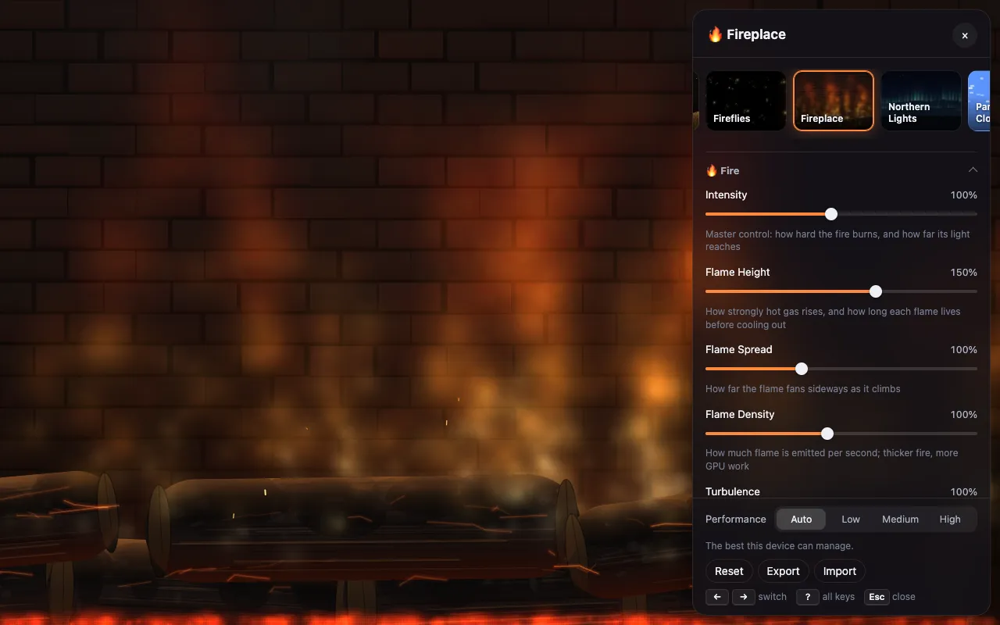

Everything is plain HTML, CSS and JavaScript, with no build step. Most
wallpapers work fully offline. The online ones, such as the Bing image of
the day, need no API keys.

> **Status: working** as a web page, a Chrome new tab and an Android live
> wallpaper (sideloaded). The plan and roadmap are in [SPEC.md](SPEC.md).

## The wallpapers

Click one to see it live.

| | | | |
|:-:|:-:|:-:|:-:|
| [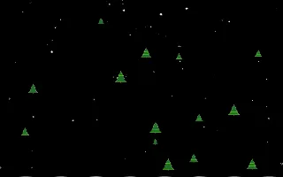](https://nealhardesty.github.io/wallpapers/?w=snow)<br>❄️ Snow | [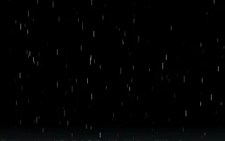](https://nealhardesty.github.io/wallpapers/?w=rain)<br>🌧️ Rain | [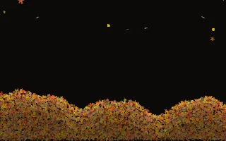](https://nealhardesty.github.io/wallpapers/?w=leaves)<br>🍂 Falling Leaves | [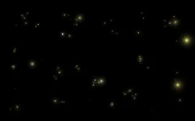](https://nealhardesty.github.io/wallpapers/?w=fireflies)<br>✨ Fireflies |
| [](https://nealhardesty.github.io/wallpapers/?w=fireplace)<br>🔥 Fireplace | [](https://nealhardesty.github.io/wallpapers/?w=northern-lights)<br>🌌 Northern Lights | [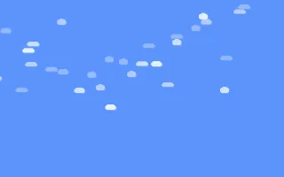](https://nealhardesty.github.io/wallpapers/?w=parallax-clouds)<br>☁️ Parallax Clouds | [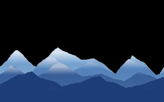](https://nealhardesty.github.io/wallpapers/?w=mountains)<br>🏔️ Mountains |
| [](https://nealhardesty.github.io/wallpapers/?w=starfield)<br>🌠 Starfield | [](https://nealhardesty.github.io/wallpapers/?w=cherry-blossoms)<br>🌸 Cherry Blossoms | [](https://nealhardesty.github.io/wallpapers/?w=halloween)<br>🎃 Halloween Night | [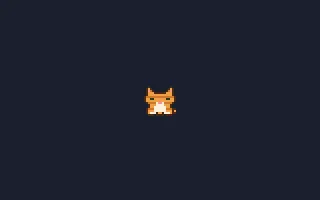](https://nealhardesty.github.io/wallpapers/?w=neko)<br>🐈 Neko |
| [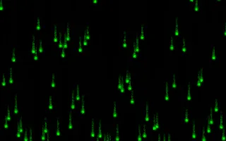](https://nealhardesty.github.io/wallpapers/?w=matrix)<br>🟩 Matrix | [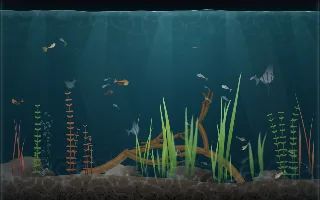](https://nealhardesty.github.io/wallpapers/?w=fishtank)<br>🐠 Fish Tank | [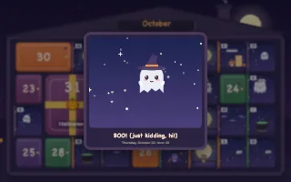](https://nealhardesty.github.io/wallpapers/?w=advent)<br>🎁 Advent Calendar | [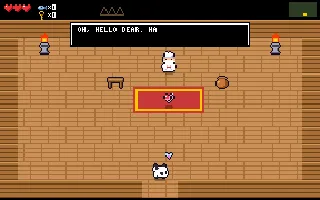](https://nealhardesty.github.io/wallpapers/?w=quest)<br>⚔️ Pixel Quest |
| [](https://nealhardesty.github.io/wallpapers/?w=harmonograph)<br>🖋️ Harmonograph | [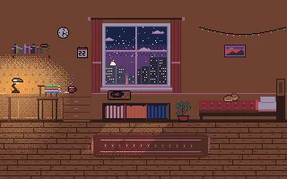](https://nealhardesty.github.io/wallpapers/?w=pixel-room)<br>🛋️ Pixel Room | [](https://nealhardesty.github.io/wallpapers/?w=girih)<br>✴️ Girih | [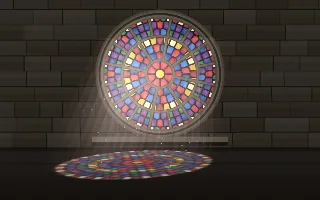](https://nealhardesty.github.io/wallpapers/?w=stained-glass)<br>⛪ Stained Glass |
| [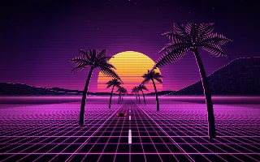](https://nealhardesty.github.io/wallpapers/?w=synthwave)<br>🌇 Synthwave | [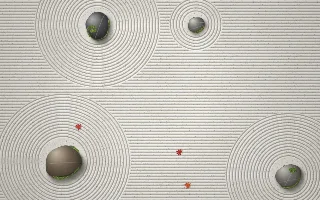](https://nealhardesty.github.io/wallpapers/?w=zen-garden)<br>🪨 Zen Garden | [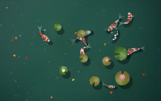](https://nealhardesty.github.io/wallpapers/?w=koi-pond)<br>🎏 Koi Pond | [](https://nealhardesty.github.io/wallpapers/?w=murmuration)<br>🐦 Murmuration |
| [](https://nealhardesty.github.io/wallpapers/?w=lanterns)<br>🏮 Lantern Festival | [](https://nealhardesty.github.io/wallpapers/?w=rainy-window)<br>🪟 Rainy Window | [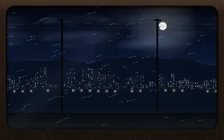](https://nealhardesty.github.io/wallpapers/?w=night-train)<br>🚆 Night Train | [](https://nealhardesty.github.io/wallpapers/?w=fireworks)<br>🎆 Fireworks |
| [](https://nealhardesty.github.io/wallpapers/?w=lighthouse)<br>🌊 Lighthouse | [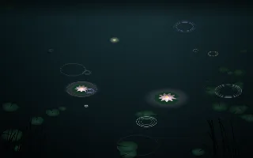](https://nealhardesty.github.io/wallpapers/?w=wiki-pond)<br>🪷 Wiki Pond | [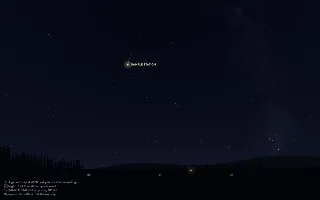](https://nealhardesty.github.io/wallpapers/?w=satellites)<br>🛰️ Satellites | [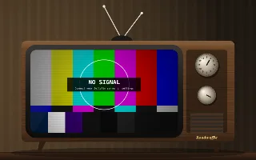](https://nealhardesty.github.io/wallpapers/?w=jellyfin)<br>📺 Jellyfin |
| [](https://nealhardesty.github.io/wallpapers/?w=harvest)<br>🌾 Harvest Valley | | | |

The second half is new: a harmonograph inking its figures, a pixel-art room
with a cat that keeps the real hours, Islamic star patterns that breathe, a
stained-glass window lit by the time of day, the synthwave drive, a zen
garden to rake, koi to feed, a starling murmuration you can scatter as the
falcon, sky lanterns to release, a rainy window to draw on, the view from a
night train, fireworks (with a New Year's countdown), a lighthouse that
keeps a real light's rhythm, every Wikipedia edit as a ripple on a pond, and
the real satellites crossing your sky. Last, **Jellyfin** 📺 plays your own
server's videos in a frame of your choice (see below). And for Thanksgiving, **Harvest Valley** 🌾: see below.

Also: **Seasonal** 📅 picks by month (the default), **Blank** ⬛ is just
black, and the **Bing Image of the Day** 🖼️ shows Bing's photo with its
credit.

## Install

**As a web page.** Open [the hosted copy](https://nealhardesty.github.io/wallpapers/), or `web/index.html`
straight from a clone, or run `make serve`. To make it Chrome's start page
without the extension, set Settings → On startup → Open a specific page to
the hosted address.

**As Chrome's new tab.** Every new tab shows the wallpaper.
1. Get the extension: `make extension` builds `dist/extension/`. Or download
   `wallpapers-extension-<version>.zip` from the latest
   [release](https://github.com/nealhardesty/wallpapers/releases) (or the
   `wallpapers-extension` artifact of a
   [CI run](https://github.com/nealhardesty/wallpapers/actions/workflows/ci.yml))
   and unzip it somewhere it can stay.
2. Open `chrome://extensions`, turn on Developer mode, click **Load
   unpacked** and pick that folder.
3. Open a new tab. Chrome asks once whether to keep the change; keep it.

Its ID is always `hajnldgffgkdnbimdihipffnimjckgcp`, whichever folder you
load it from, so a new version unpacked somewhere else keeps your settings.

Chrome puts the cursor in the address bar on a new tab, so click the page
once before pressing `,`, or use the gear in the top-right corner. The
extension asks for one permission, reading `www.bing.com`, so the Bing
wallpaper can fetch its photo; nothing else leaves your machine.

**Moving from the old homepage.** Its wallpaper settings come with you:
the wallpaper you'd picked, every setting you changed, and the advent
calendar's memory of the last door it celebrated. Settings you never
touched take today's defaults. Links, weather, search and clocks stay
behind.
1. On an old homepage tab, open the console (⌥⌘J on a Mac, Ctrl+Shift+J
   elsewhere). If Chrome asks, type `allow pasting` first. Paste this and
   press Enter; it downloads `homepage-wallpapers.json`, and reads nothing
   but the wallpaper keys:

   ```js
   (() => {
     const keep = k => /Config$/.test(k) || ['wallpaperPreference', 'adventCelebrated', 'adventLastSeen'].includes(k);
     const data = { app: 'homepage', exported: new Date().toISOString(),
       localStorage: Object.fromEntries(Object.keys(localStorage).filter(keep).map(k => [k, localStorage.getItem(k)])) };
     const a = document.createElement('a');
     a.href = URL.createObjectURL(new Blob([JSON.stringify(data, null, 2)], { type: 'application/json' }));
     a.download = 'homepage-wallpapers.json';
     a.click();
   })();
   ```
2. In `chrome://extensions`, turn the old homepage off, and install this
   extension (above).
3. Open a new tab, press `c` (or `,`), choose **Import** and pick the file.
   A note says what came over.

The same file imports on the hosted copy and in the Android app.

**On Android, as a live wallpaper.** Download `wallpapers-<version>.apk`
from the latest [release](https://github.com/nealhardesty/wallpapers/releases)
(or `make android-install` with a phone connected) and install it; your
phone asks you to allow installs from the browser once. Open **Wallpapers**
from the app drawer: it's the panel, with a **Set as wallpaper** button.
On the home screen, taps and drags reach the wallpaper (feed the fish, wake
the cat), and the mountains, clouds and stars pan as you swipe between
pages. It pauses whenever it's covered, and runs at Medium and 30 fps at
most, lower on battery saver or when the phone is warm.

**On a Mac, as your desktop background** (macOS 14 or later, experimental). Run
`make mac-run`, or `make mac-install` to put the app in `~/Applications`. The
wallpaper sits behind your desktop icons, widgets and windows, on every
display, and the ✨ menu bar item picks a wallpaper, pauses it, opens
**Settings** (the same panel) and sets it to open at login. It pauses when a
full-screen app covers it, when the screen sleeps or locks, and it runs at a
lower quality on battery, in Low Power Mode and when the Mac is hot. Wallpapers
that react to the mouse do: fish follow the pointer, and a click on the bare
desktop is a tap. **Use as Lock Screen Picture…** renders a still and sets it
as your desktop picture, because a live wallpaper can't show on the lock
screen. The app isn't notarized (no paid developer account), so building it
yourself is the easy way in. Or download `wallpapers-mac-<version>.zip` from the
latest [release](https://github.com/nealhardesty/wallpapers/releases) (a
universal build for Apple silicon and Intel; check it against the `.sha256`
beside it), unzip it, and move `Wallpapers.app` to `~/Applications`. macOS
blocks a downloaded app that isn't notarized the first time: right-click →
**Open**, or clear the flag with `xattr -dr com.apple.quarantine
~/Applications/Wallpapers.app`.

**On a Mac, as a screen saver.** The app carries one, and installs it for you:
✨ → **Screen Saver → Install Screen Saver…**. macOS wants you to choose it
yourself, once: System Settings → Wallpaper → **Screen Saver**, scroll to the
bottom (**Other**) and pick **Wallpapers**. From the same menu you choose what it
shows: the same wallpaper as your desktop, a different one each time (changing
every 1, 5, 15 or 30 minutes, and a different one on each display), or one in
particular, and whether to float a quiet clock over it. **Preview Now** runs it
at once. The saver follows your settings in the app, which keeps them where the
saver can read them. If macOS's screen saver host ever stalls the page, the
saver reloads it, and failing that shows a clock on black rather than a broken
screen. An update of the app updates the saver by itself.

**On any phone,** without installing anything: open the hosted copy and
choose *Add to Home screen*. It opens full screen, with no browser around
it. Hold a right-hand corner for the panel.

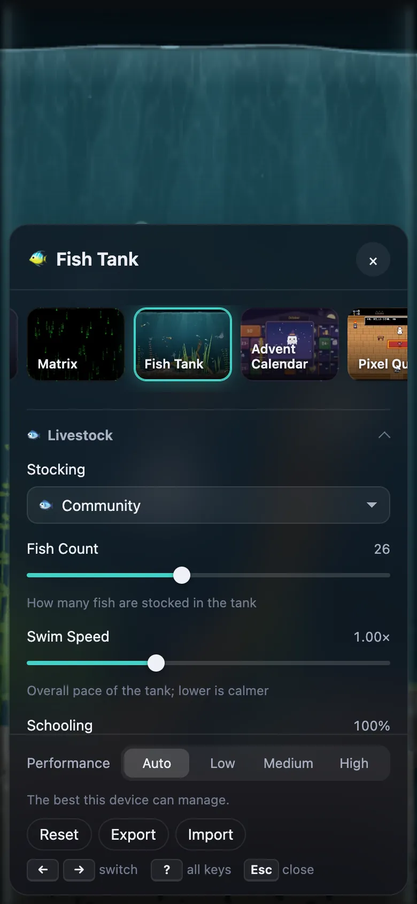


## Harvest Valley

A calm, cosy autumn valley, built for Thanksgiving, with a switch on every
part of it. A village with smoking chimneys and a windmill, patchwork
farmland, corn and a scarecrow with a crow, a pumpkin patch, an apple
orchard whose apples fall, tumble and get carried off by squirrels to a very
small door, turkeys and sleepy cats about the meadow, geese in a V overhead
(the leader drops to the back now and then), leaves on the wind, valley mist
and slanting sunbeams.

The sky is real: the sun's path for the date, the moon in tonight's actual
phase (rising and setting where it would, bright limb towards the sun, and
named: the Harvest Moon, the Hunter's, the Beaver), a shooting star now and
then. After dark the windows light, the lamps come on and there's a bonfire
on the green. In Thanksgiving week the bunting spells *give thanks*.

And it has a secret. On a dark night, now and then, the most sincere pumpkin
in the patch has been known to rise. (Press `G` to wait for it.)

Everything is in the panel: time of day (live, a whole day in a few minutes,
or pinned to day, golden hour or night), the sun, the moon, its phase and
size, stars, clouds, geese, the village and each part of it, fields, the
scarecrow, the patch, the orchard (trees, apples, squirrels, turkeys, cats),
leaves, wind, mist, sunbeams, and the autumn colours: seven presets, or your
own palette of up to eight. Leave out the village and the orchard for a
bare moon over a dark field, or turn off the day for a night with only the
moon. `?date=2026-11-26T17:00` shows any date and hour.

## Use

You see only the wallpaper. On first run it's **Seasonal**: snow from January to
April, the fish tank in May, fireflies in summer, falling leaves in
September, Halloween in October, Harvest Valley in November and the advent
calendar in December.

| Key | Action |
|---|---|
| `,` or `c` | The panel: every wallpaper, and the current one's settings |
| `[` / `]` | Previous / next wallpaper (remembered) |
| `←` / `→` | Switch, while the panel is open |
| `f` | Fullscreen |
| `k` | The clock, on or off |
| `?` | All keys, including the current wallpaper's own |
| `Esc` | Close |

On a touch screen, hold a right-hand corner to open the panel. With a
mouse, a gear appears when you move toward that corner. The bottom-right
corner works too, and the two left-hand corners toggle fullscreen.

**The panel:**
- Every wallpaper, with a thumbnail. Hover one for a moment to see it play.
- The current wallpaper's settings, which take effect as you change them.
  A dot marks anything you've changed; click it to put that setting back.
- Performance: **Auto** (the default) watches how long each frame takes
  and gives up detail in small steps when the device struggles, then
  takes it back when it's calm; it remembers where each wallpaper settled.
  **Low**, **Medium** and **High** pin it. Low draws fewer pixels, frames
  and particles, and drops expensive effects such as bloom and blur.
  Under it, a live readout shows what's happening.
- **Save power on battery** (on by default): on battery, Auto stays at
  Medium or below, and Low under 20%.
- ⚡ badges on the tiles show how hard each wallpaper works a phone.
- Reset, plus Export and Import, to move your settings to another browser.

**A clock over any wallpaper** (off by default; `k` or the 🕐 Clock row in the
panel, just under the wallpapers, turns it on). It's one collapsed row until
you tick it, then seven, with the rest folded away:
- **Time:** digital, in words ("quarter to eleven"), Roman numerals, a
  binary or hexadecimal clock, or Swatch beats. 12 or 24 hour, seconds, a
  blinking colon, any timezone.
- **Date:** none, weekday, short, long, numbers or ISO, plus extras you can
  add: the timezone, UTC offset, week number, day of the year, quarter, days
  left in the year, the moon's phase, the Unix time.
- **A second, smaller clock** for another timezone (UTC to begin with), that
  says "tomorrow" or "yesterday" when its date differs.
- **Looks** set the style in one go (Minimal, Neon, Terminal, Newsprint,
  Frosted, Retro LCD, Sunset, Blueprint); or choose the font (system fonts,
  or the name of one you have installed), weight, size, colour (one colour, a
  gradient, light or dark to suit the wallpaper under it, the time of day, a
  slowly shifting hue, or inverted against what's behind it), a shadow, glow
  or neon, an outline, and a backing plate.
- **Where it goes:** a corner or edge (drag it anywhere while the panel is
  open), drifting about the screen, bouncing off the edges, teleporting to a new
  spot every so often, or following the pointer. Moving costs the page almost
  nothing; on battery saver or with reduced motion it keeps still.
- **At night** it can dim or hide itself, and you can keep it off any
  wallpaper you choose. `?clock=on`, `?clock=off` or `?clock=bounce` (and the
  other positions) try it for one page load.

**Some wallpapers have their own keys** (press `?` to see them):
- Pixel Quest: `N` new quest, `H` hero, `V` look, `T` hat, `M` companion,
  `P` palette. Arrows or WASD and Space take over the hero.
- Advent calendar: arrows time-travel, `0` today, `T` theme, `R` replay.
- Harmonograph `N` new drawing · Girih `N` next pattern, `T` tiling ·
  Stained Glass `N` new window · Pixel Room `L` lamp, `P` pet the cat ·
  Zen Garden `N` new stones, `R` rake, `E` smooth · Murmuration `D` falcon
  dive, `R` roost, `N` new evening · Lantern Festival `L` or Space release
  one · Rainy Window `W` wipe · Fireworks Space or `L` launch, `G` finale ·
  Lighthouse `L` next light, `S` sea state · Satellites `N` next station pass ·
  Harvest Valley `G` wait for the Great Pumpkin, `H` call the geese, `W` a gust,
  `M` what the moon is doing.

**Touch and drag:** tap or drag on Zen Garden (rake), Koi Pond (ripples;
feed them in settings), Murmuration (you're the falcon), Lantern Festival,
Rainy Window (draw in the fog), Fireworks, Pixel Room (the cat and the lamp),
Harvest Valley (shake an apple tree; tap the scarecrow, or the sky for geese)
and Satellites (what's that one?). Each has a setting to ignore touch. On
Android, a quick sideways swipe changes home screens and never counts.

**Online, but never blank:** Satellites (CelesTrak's orbits), Wiki Pond
(Wikipedia's live edits) and Lighthouse (Open-Meteo's swell, only with Live
Swell on) need no keys and draw their own scene offline. Satellites asks
where you are, in its settings: type a town, or allow your location. It's
rounded to about 10 km and stays in your browser.

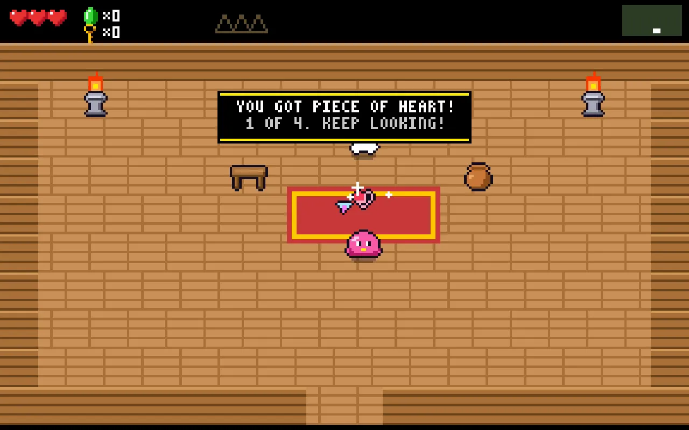

### Jellyfin 📺

Your own [Jellyfin](https://jellyfin.org) server's videos, playing behind
everything: a playlist (shuffled, by default), random picks from a library,
or your favourites. They play inside a frame drawn in code: an old TV, a
mantel over a crackling fire, a drive-in under the stars, a cinema whose
curtains close between films, a gilt frame in a gallery, a glow that spills
the picture's colours onto the wall, a camcorder viewfinder or a VHS deck, a
submarine porthole, an arcade cabinet, or none at all. **Seasonal** picks
the mantel in winter and the drive-in in summer.

To connect:
1. Open the panel (`,`), pick 📺 Jellyfin, type your server's address
   (`nas.lan:8096`, an IP address, or an https address), and press **Connect**.
2. Press **Sign in with Quick Connect**. Six digits appear. In any Jellyfin
   app you're signed in to, open Quick Connect (on the web: your profile →
   Quick Connect) and enter them. No password ever touches the wallpaper.
   Servers with Quick Connect off can use a username and password instead;
   the password goes to your server once and is never stored.
3. Pick a playlist, a library or your favourites. Sign out tells the server
   to forget this device.

What it does for you:
- Every start is muted; `M` or a tap on 🔇 gives sound. Each item carries
  on where it left off, in any new tab.
- Subtitles come on by themselves: a full track in your language, then a
  forced one, then the file's default. With audio in another language,
  "forced only" shows full subtitles. Picture subtitles (PGS, DVD) are
  burned in by your server.
- Only one tab plays at a time; the others hold their last picture and free
  the decoder. The server sends no more than the tier needs (480p on Low,
  720p on Medium or on battery), and with battery saver on it shows each
  item's poster, slowly drifting, instead of video.
- The sign-in stays on this device: Export leaves it out, and logs never
  show your server's address.

Where it works: everywhere, with one catch per place.

| Here | http server at home | https server |
|---|---|---|
| The extension, or `web/index.html` from disk | Just works | Just works |
| The hosted copy (GitHub Pages) | Allow Chrome's "local network" prompt, and type the server's **IP address** (Chrome blocks an http name such as `nas.lan` from an https page) | Allow the prompt |
| Android | Allow "Nearby devices" when asked (Android 17 calls reaching your home network that) | Just works |

On Android, it plays clips instead of whole films, and posters while on
battery, so full video plays while charging.

Keys: `Space` pause, `M` sound, `N`/`P` next and previous, `←`/`→` 30 s,
`S` subtitles, `I` what's playing, `V` next frame.

The Bing photo needs a connection. The hosted copy and the extension just
work. Locally, a browser only lets a page reach it when the page is served:
run `make bing-json` and then `make serve`. Opened straight from disk, it
explains this instead (or uses public proxies, if you allow them in its
settings).

**URL options**, for this visit only; nothing is saved:

| Add to the URL | Effect |
|---|---|
| `?w=fishtank` | Show this wallpaper |
| `?panel=open` | Open its settings on load |
| `?date=2026-12-25` or `?date=2026-12-31T23:59:50` | Time-travel any wallpaper that follows the date or hour; the clock ticks on from there. With advent, `&theme=` picks a theme |
| `?tier=low` | Low, medium or high performance tier (fewer pixels and frames on low) |
| `?hud=1` | A corner readout: frame rate, frame cost, quality step, power |
| `?seed=7` | The same random scene every time |

`web/stage.html?w=<id>` shows a single wallpaper on its own, without the
player around it.

## Development

Requirements:
- `make`, `git` and Node.js 22 or later
- Google Chrome or Chromium, for `make smoke` (set `CHROME_PATH` if it isn't
  found)
- `openssl`, for `make serve-https`
- Docker, for the container
- For Android: the Android SDK and a JDK 17 or later. With Android Studio
  installed in the usual place, the Makefile finds both (`ANDROID_HOME=`
  and `JAVA_HOME=` override). Gradle comes with the wrapper.

There are no npm packages to install.

First time in a fresh clone:

```sh
make hooks   # audit every commit, commit message and push
make ci      # lint, audit and test: the same thing CI runs
```

Run `make` to list every target.

| Target | What it does |
|---|---|
| `make hooks` | Install the git hooks in `.githooks/` |
| `make serve` | Serve `web/` at http://localhost:8000 (`PORT=` to change, `HOST=0.0.0.0` to reach it from a phone) |
| `make serve-https` | The same over https at https://localhost:8443, with a self-signed certificate made on first use |
| `make cert` | Make a fresh self-signed certificate in `.cert/` (localhost and your LAN addresses) |
| `make bing-json` | Fetch Bing's last eight images of the day into `web/bing.json`, so the Bing wallpaper works when served |
| `make thumbnails` | Re-render the panel's wallpaper thumbnails (they're committed: review the changes) |
| `make icons` | Render `web/icons/icon.svg` to the PNG icons the extension and web app need (committed) |
| `make screenshots` | Re-render the README's screenshots in `docs/` (committed: review the changes) |
| `make extension` | Build the Chrome extension: `dist/extension/` to load unpacked, and a zip |
| `make site` | Build the GitHub Pages copy in `dist/site/`, with a fresh `bing.json` |
| `make open` | Open `web/index.html` in your default browser (from `file://`, no server needed), or bring its tab forward if it's already open (macOS, Chrome and Safari). `make open PAGE='?w=harvest'` opens a particular wallpaper |
| `make bench` | Every wallpaper at every tier on a simulated phone (4× slower CPU), then the clock overlay's cost; checks the budgets, writes `bench/results.json` and the ⚡ badges |
| `make bench-clock` | Just the clock overlay's cost: a bouncing clock with seconds against none |
| `make jellyfin-media` | Generate made-up test videos (patterns, tones, subtitles in several kinds) into `.jellyfin/media/`; needs `ffmpeg` |
| `make jellyfin-dev` | Run a throwaway Jellyfin in Docker at http://localhost:8096 on that media, set up on first start (user `wallpapers`, password `wallpapers`, a playlist) |
| `make jellyfin-stop` | Stop and remove that container (`.jellyfin/` stays; delete it to start over) |
| `make jellyfin-mock` | Serve the smoke run's fixture Jellyfin at http://localhost:8097 (user `fixture`, password `fixture-pw`), when Docker isn't handy |
| `make jellyfin-fixtures` | Regenerate the smoke run's tiny clip and backdrop in `tools/fixtures/jellyfin/` (committed) |
| `make android-build` | Build the Android debug APK |
| `make android-install` | Install it on the connected phone or emulator and open it |
| `make android-logcat` | Follow the app's log, including the page's console |
| `make android-emulator` | Boot an emulator in the background (`AVD=`, `EMULATOR_FLAGS=-no-window`) |
| `make android-bench` | On a phone with the debug build set as wallpaper: frame cost, CPU and battery drain per wallpaper per tier |
| `make android-keystore` | Make the release signing key, outside the repo (once, ever) |
| `make android-release` | Build the signed release APK into `dist/` |
| `make mac-build` | Build the macOS app, `dist/mac/Wallpapers.app` (needs Xcode's command line tools; `ARCHS="arm64 x86_64"` for a universal build) |
| `make mac-run` | Build it and start it: the wallpaper goes behind your desktop icons |
| `make mac-dev` | Run it straight from this checkout's `web/`, with the web inspector on, so edits show on reload |
| `make mac-test` | The app's self-test against a throwaway settings store: windows and layering, animation, pause, settings sharing, mouse, Bing, still (about 30 s) |
| `make mac-release` | Build the universal macOS app and zip it into `dist/wallpapers-mac-<version>.zip` with a `.sha256`; it checks both architectures, the versions and the signatures first |
| `make mac-saver-test` | Load the built screen saver outside Apple's host and check its settings, choices, displays, clock and watchdog (about a minute; shows a window) |
| `make mac-saver-live` | Run the installed saver in Apple's real host for a few seconds and read its log (once you've chosen it in System Settings) |
| `make mac-saver-log` | The screen saver's own log |
| `make mac-install` / `make mac-uninstall` | Put the app in `~/Applications` / remove it |
| `make docker-build` | Build the container image `wallpapers` |
| `make docker-run` | Run it at http://localhost:8000 (read-only, unprivileged) |
| `make lint` | Syntax-check every script and JSON file |
| `make audit` | Scan the working tree for anything private (see below) |
| `make audit-staged` | Scan only what is staged for commit |
| `make audit-history` | Scan every file version ever committed |
| `make test` | Run the unit tests |
| `make smoke` | Build the extension, then boot every wallpaper, the player and the extension in headless Chrome; screenshots go to `dist/smoke/` |
| `make smoke-clock` | Just the clock overlay's checks in headless Chrome (about a minute); screenshots go to `dist/smoke/clock-*.png` |
| `make smoke-live` | The same stage and player checks against the deployed site, with real network and Bing (`SMOKE_URL=` for another, e.g. `make serve`'s); CI runs it after every deploy |
| `make ci` | Everything CI runs: lint, audit, audit-history, test, smoke |
| `make clean` | Remove build output |

### Trying Jellyfin

`make jellyfin-media` then `make jellyfin-dev` gives you a real Jellyfin with
made-up videos, a playlist and every subtitle case, at
http://localhost:8096. Point the wallpaper at `localhost:8096` and sign in
as `wallpapers` / `wallpapers`, or approve a Quick Connect code from
Jellyfin's own web page there. It listens on this computer only. For a
phone on your network, `make jellyfin-stop`, then
`JELLYFIN_HOST=0.0.0.0 make jellyfin-dev` and use this computer's address.
The Android emulator's alias for this computer can't reach Docker Desktop's
localhost ports, but it can reach `make jellyfin-mock` (port 8097).

### HTTPS and phones

To try the wallpapers on a phone, serve them on your network:
`HOST=0.0.0.0 make serve-https`, then open the printed address. The
certificate is self-signed, so the browser warns once. Accept it, or trust
`.cert/cert.pem` on the device. HTTPS matters off localhost because some
browser features only work on secure pages.

### Releasing

1. Once: `make android-keystore`, back the key up somewhere safe, and add
   the four `WALLPAPERS_KEY*` secrets it prints to the GitHub repo
   (`gh secret set`). Losing the key means people must uninstall to
   update.
2. Bump `version` in `web/manifest.json` (it's the extension's and the
   app's version), commit, and push a matching tag: `git tag v0.6.0 &&
   git push --tags`.
3. CI checks everything, builds the signed APK, the extension zip and the
   universal Mac app (on a macOS runner), and publishes all three on a GitHub
   Release: `wallpapers-<version>.apk`, `wallpapers-extension-<version>.zip` and
   `wallpapers-mac-<version>.zip` with its `.sha256`. Until the secrets exist it
   publishes the debug APK (`wallpapers-<version>-debug.apk`) instead: it
   sideloads fine, but each one is signed by a throwaway key, so installing the
   next release means uninstalling first.
4. The Mac build is the newest part: if it fails, the release still goes out
   without it and the run shows a warning saying so. The Mac app is ad-hoc
   signed, not notarized, so there is nothing to set up for it. (A paid Apple
   Developer account would add a Developer ID certificate, a notarization step
   in `mac/release.sh` and a few secrets; nothing else changes.)
5. To try the Mac job before tagging: `gh workflow run ci.yml --ref <branch>`
   runs CI, the Android build and the Mac build, and uploads the zip as the
   `wallpapers-mac` artifact, without publishing anything.

### Adding a wallpaper

See "Building a new wallpaper" in [AGENTS.md](AGENTS.md). In short: a folder
under `web/wallpapers/` with the code, `defaults.js` and `settings.js`, an
entry in `catalog.js`, `make thumbnails`, and `make ci`.

### Keeping it public-safe

This is a public repo, so `make audit` fails if it finds any of these:

- private IP addresses
- email addresses, other than `noreply@`
- home-directory paths
- strings shaped like API keys
- URLs that aren't on the allowlist in `tools/audit.mjs`
- image metadata
- files over 1 MB

Put your own personal terms (names, hostnames, employer) one per line in
`.audit-denylist` at the repo root. Git ignores that file, so the list
stays private while every commit is still checked against it.

With `make hooks` installed, the audit runs three times:

- before each commit, on exactly what's staged
- on each commit message
- before each push, on the full history, since a secret that was committed
  and then deleted is still public once pushed

Findings are redacted in the output. If one is a false positive, add
`audit-allow: <reason>` on that line or the line above.

## License

[MIT](LICENSE)
